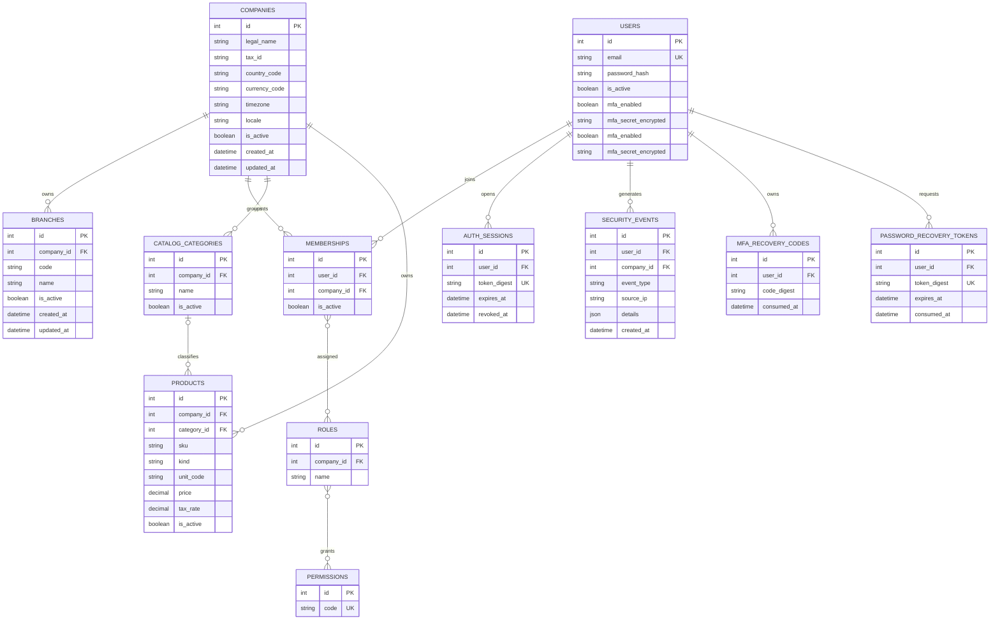

# Arquitectura inicial

## Capas y dependencias

```text
Cliente HTTP → API (FastAPI) → casos de uso del módulo → SQLAlchemy → PostgreSQL
                                      ↓
                            esquemas Pydantic
```

Los módulos empresariales se ubican en `backend/app/modules/<módulo>` y no deben importar rutas API. `core` contiene configuración compartida; `database` administra sesiones y metadatos; `api` solo traduce HTTP a casos de uso. Integraciones, auditoría y reportes se añadirán como módulos separados cuando sus primeros flujos lo requieran.

## Módulos y dependencias previstas

- Plataforma: empresas/sucursales → usuarios, membresías, roles/permisos → auditoría/configuración.
- Operación: catálogo de productos → inventario; compras y ventas integran inventario.
- Finanzas consume eventos/documentos de compras, ventas e inventario con asientos balanceados y correcciones trazables.
- RR. HH., fabricación, mantenimiento, proyectos y reportes se incorporarán incrementalmente.

## Modelo entidad-relación inicial



Una sucursal tiene un código único dentro de su empresa. El acceso de una persona requiere una membresía activa por empresa; los roles de esa membresía agregan permisos. Las claves TOTP se cifran con Fernet; códigos de recuperación y tokens de restablecimiento se persisten en forma digestada. El outbox conserva el token cifrado hasta entrega/expiración. La auditoría rechaza `UPDATE` y `DELETE` mediante triggers, y requiere un proceso futuro de retención compatible con esa política. Un token de sesión aleatorio se entrega al cliente, pero solo su SHA-256 se persiste; la contraseña se guarda como PBKDF2-HMAC-SHA256 salteado.

El catálogo actual es multiempresa, con categorías, productos y servicios, SKU único por empresa y precios/impuestos decimales validados. No guarda saldos de inventario: existencias deberán calcularse a partir de movimientos trazables. `unit_code` aún no tiene un catálogo de unidades de medida y `tax_rate` es solo un porcentaje configurable, no una determinación fiscal.
